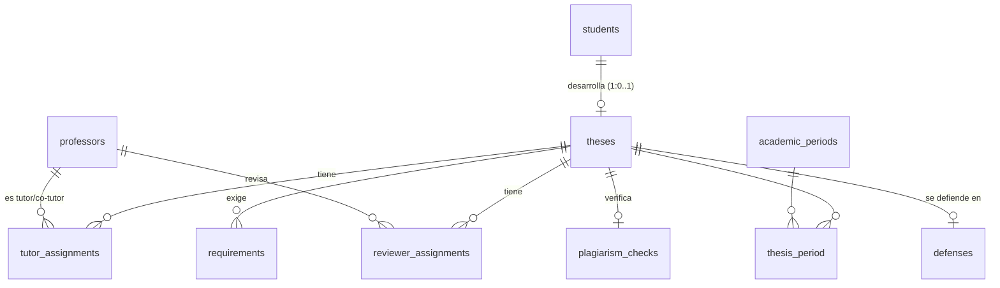

# Thesis Management — Documento de Punto de Partida

> **Propósito:** consolidar y validar lo que existe del semestre anterior (documentación en `Docs/` y código en `Thesis-Management/`) para fijar una línea base técnica antes de redactar el *Project Proposal* de Aplicaciones Web.
> **Línea base acordada:** la base de datos **tal como la crea hoy el código** (`thesis_api/models.py` vía `db.create_all()`), no la de los documentos. Ver §3 para el porqué.
> **Fecha de revisión:** 2026-10-14.

---

## 0. Resumen ejecutivo

| Aspecto | Veredicto |
| :--- | :--- |
| Idea del producto y requisitos (FR/NFR) | **Bien planteados.** Cubren el flujo real de titulación. Son la mejor pieza heredada. |
| Diseño de base de datos | **Incompleto e inconsistente.** Existen **4 versiones distintas** del esquema (docs, `database.sql`, Power Architect, ORM) que no coinciden entre sí. El esquema real solo cubre ~50 % de los requisitos funcionales. |
| Backend (Flask) | **Prototipo funcional, no reutilizable (DEC-11).** CRUD básico de estudiantes/tesis, parcial de profesores, defensas y asignaciones. Sin autenticación, sin validaciones de negocio, credenciales en el código. Se reescribe; solo se conservan los modelos. |

**Conclusión:** el proyecto sirve como punto de partida conceptual, pero antes de construir la aplicación hay que **cerrar el modelo de datos** (v2) resolviendo las decisiones de §7. El resto de la aplicación depende de eso.

> **Fuera del alcance de este documento (DEC-10):** la infraestructura y la interfaz de usuario se construirán desde cero en el nuevo proyecto. Por eso aquí no se evalúan la interfaz heredada (`thesis-dashboard/`), la infraestructura de despliegue ni los porcentajes de avance declarados el semestre anterior.

### 0.1 Registro de decisiones

| ID | Fecha | Decisión | Consecuencia |
| :--- | :--- | :--- | :--- |
| DEC-01 | 2026-10-14 | **Fuente de verdad del esquema: `thesis_api/models.py`** (esquema real, §3.1). Convención de nombres: tablas en `snake_case` plural. | `database.sql`, `Logical ERD.png` y el modelo `.architect_` se movieron a `Docs/legacy/` como históricos. Todo cambio futuro al esquema se hará como migración versionada (Alembic), y el diagrama E-R se regenerará desde el esquema, no se dibujará a mano. |
| DEC-02 | 2026-10-14 | **Fase actual: solo documentación.** No se modifica código hasta tener aprobado el Project Proposal. | Las correcciones de §4–§5 se registran aquí como cambios planificados, no se aplican todavía. |
| DEC-03 | 2026-10-14 | **`tutor_assignments`: PK `(thesis_id, role)` + `UNIQUE (thesis_id, professor_id)`** (opción A). Sin historial de reemplazos de tutor por ahora. | La BD garantiza ≤ 1 Tutor, ≤ 1 Co-Tutor y tutor ≠ co-tutor. "Tutor obligatorio" se valida al avanzar de estado; "tutor ≠ revisor" en la capa de servicio. Reemplazar un tutor = actualizar la fila; si luego se requiere trazabilidad, se cubre con la auditoría general (§8.2). Resuelve I-1 y la brecha de FR-04. |
| DEC-04 | 2026-10-14 | **Revisores: máximo 3 siempre; exactamente 3 para avanzar** a revisión final / defensa. | Trigger `BEFORE INSERT` + validación en servicio para el máximo; validación en la transición de estado para el mínimo. Corrige la contradicción FR-05 ("estricta de tres") vs. `Avances_realizados.md` ("hasta 3"). |
| DEC-05 | 2026-10-14 | **Los 3 revisores del manuscrito forman también el tribunal de defensa.** | Se mantiene `reviewer_assignments` con `role` ∈ {President, Committee} (ahora `ENUM NOT NULL`), exactamente 1 President por tesis, y se añade `grade` (nota individual 0–10). No se crea `defense_committee`. Resuelve D-4. |
| DEC-06 | 2026-10-14 | **Cardinalidades corregidas y diagrama conceptual en Mermaid** dentro de `Docs/Design.md`. | `Design.md` reescrito con el esquema real y la lectura bidireccional de cardinalidades; `ERD.png` archivado en `Docs/legacy/`. |
| DEC-07 | 2026-10-14 | **Inician sesión: administración, profesores y estudiantes.** Roles fijos de usuario: `admin`, `professor`, `student`. "Tutor" y "revisor" **no son roles de usuario**: son permisos que se derivan de `tutor_assignments` / `reviewer_assignments` para cada tesis. | Nueva tabla `users` (§8.2). Corrige NFR-05, que listaba tutor y revisor como roles. Qué puede hacer el estudiante además de consultar su avance depende de D-7 (documentos). Resuelve D-1 (roles) y D-2 (acceso del estudiante). |
| DEC-08 | 2026-10-14 | **Auditoría: `created_at`/`updated_at` en todas las tablas + `thesis_status_history`.** Sin log general de todas las tablas. | El historial lo inserta el servicio en la misma transacción que el cambio de estado (un trigger no conoce al usuario autenticado). El tipo de estado se cierra con D-5. |
| DEC-09 | 2026-10-14 | **Catálogo de aulas y horario real de defensa:** `rooms` + `defenses.room_id`, `scheduled_at`, `duration_minutes`, `meeting_url` (virtual). | La API rechaza defensas que se solapan en la misma aula o con el mismo miembro del tribunal. Habilita el reporte "Defense Room Availability". Resuelve I-6. |
| DEC-10 | 2026-10-14 | **Infraestructura e interfaz se construyen desde cero en el nuevo proyecto.** La interfaz heredada (`thesis-dashboard/`) no se reutiliza ni se toma como referencia, y no se consideran los porcentajes de avance del semestre anterior. | Se retiraron de este documento la evaluación del frontend, de la infraestructura (Docker, CI, despliegue) y del avance declarado, así como la arquitectura objetivo. Su definición pasa al Project Proposal. Este documento queda centrado en la base de datos y la API heredadas. |
| DEC-11 | 2026-10-14 | **El backend se reescribe desde cero; solo se conservan los modelos.** `thesis_api/models.py` sirve de base para la migración inicial (esquema §3.1), y las migraciones siguientes aplican la v2 (§8). El código de rutas (`routes.py`, `app.py`, `recreate_db.py`) no se reutiliza. | Casi todos los endpoints cambian igual por DEC-03…DEC-09, y el código heredado no tiene capa de servicios, manejo de transacciones ni tests (§5.3). §5 queda como referencia de comportamiento y de errores a no repetir. **El framework (Flask o FastAPI) se decide en el Project Proposal**; la recomendación de §2 queda abierta. |
| DEC-12 | 2026-10-15 | **Backend en FastAPI** (el grupo lo domina mejor), con SQLAlchemy 2.0 + Alembic sobre MySQL 8. | Validación con Pydantic y documentación OpenAPI/Swagger integradas. Cierra la fila "API" de §2. |

---

## 1. Inventario de lo heredado

### 1.1 Documentación (`Docs/`)

| Archivo | Contenido | Estado |
| :--- | :--- | :--- |
| `Proposal y Requirements.md` | Objetivos, alcance, problemática, FR-01…FR-10, NFR-01…NFR-06 | Útil. Objetivos orientados a la materia de BD (hay que reescribirlos para Aplicaciones Web). |
| `Design.md` | Entidades, cardinalidades y diagrama conceptual | **Reescrito (DEC-06)** con el esquema real y cardinalidades corregidas. |
| `legacy/ERD.png` | Diagrama E-R conceptual (Chen) | **Archivado (DEC-06):** cardinalidades incorrectas. |
| `legacy/Logical ERD.png` / `legacy/*.architect_` | Modelo lógico en SQL Power Architect (10 tablas) | **Archivado (DEC-01).** Difiere del DDL y del ORM (§3). |
| `legacy/database.sql` | DDL mínimo (7 tablas, sin `NOT NULL`, sin `Requirement`/`AcademicPeriod`) | **Archivado (DEC-01).** |
| `Avances_realizados.md` | Arquitectura, diccionario de datos, DDL, endpoints, pantallas, roadmap | Su DDL y su tabla de endpoints **no coinciden con el repositorio** (§3, §5.1). |

### 1.2 Código (`Thesis-Management/`, 5 commits)

```
Thesis-Management/
├── thesis_api/               # Backend Flask
│   ├── app.py                # create_app(), credenciales MySQL hardcodeadas
│   ├── models.py             # 9 modelos + 1 tabla puente  ← FUENTE REAL DEL ESQUEMA
│   ├── routes.py             # un solo Blueprint con todos los endpoints
│   ├── recreate_db.py        # DROP + CREATE de todas las tablas
│   └── requirements.txt      # Flask 3.0.3, Flask-SQLAlchemy 3.1.1, Flask-Cors 4.0.0, PyMySQL 1.1.0
└── thesis-dashboard/         # Frontend React — no se reutiliza (DEC-10)
```

---

## 2. Stack tecnológico — validación

| Capa | Documentado | Realmente usado | Validación / Recomendación |
| :--- | :--- | :--- | :--- |
| RDBMS | MySQL 8.0+ / MariaDB | MySQL (BD `TestDB`, usuario `root`) | ✅ Mantener **MySQL 8.0.16+** (desde esa versión los `CHECK` se aplican de verdad; en versiones anteriores y en algunas de MariaDB se ignoran o difieren). Eliminar "/ MariaDB" del documento para no ambigüedad. |
| ORM | SQLAlchemy | Flask-SQLAlchemy 3.1 / SQLAlchemy 2.0 | ✅ Mantener SQLAlchemy 2.0 (sirve tanto con Flask como con FastAPI). El código heredado usa `Query.get()`, deprecado; no aplica al reescribir (DEC-11). |
| Migraciones | "migraciones versionadas" (NFR-06) | **Ninguna** — se usa `db.create_all()` y `recreate_db.py` (borra todo) | ❌ Incumple NFR-06. Adoptar **Flask-Migrate (Alembic)** desde el primer día de la v2. |
| API | Flask **o** FastAPI | Flask 3.0 | ✅ **FastAPI (DEC-12).** Contexto de la decisión (DEC-11): Al no reutilizarse el código, el criterio es el dominio del grupo. Flask requiere añadir validación (marshmallow/pydantic), OpenAPI (`flask-smorest`) y JWT (`flask-jwt-extended`); FastAPI trae validación (Pydantic) y Swagger integrados. Ambos usan SQLAlchemy 2.0 + Alembic. |
| CORS | — | Flask-Cors 4.0.0, abierto a todos los orígenes | ⚠️ 4.0.0 tiene vulnerabilidades conocidas. En el backend nuevo: versión actual y orígenes restringidos. |
| Modelado | SQL Power Architect | Archivo `.architect_` desactualizado | ✅ Resuelto en DEC-01/DEC-06: el diagrama se mantiene en Mermaid (`Docs/Design.md`) y se regenera desde el esquema. |
| Autenticación / roles | Exigida por NFR-05 | **Inexistente** | ❌ Requisito crítico para "producción". Modelo decidido en DEC-07. |

> El stack de frontend e infraestructura no se evalúa aquí (DEC-10); se definirá en el Project Proposal.

---

## 3. Base de datos — las 4 versiones y cuál es la real

| Elemento | `database.sql` | DDL en `Avances_realizados.md` | Power Architect (`.architect_`) | **ORM `models.py` (REAL)** |
| :--- | :--- | :--- | :--- | :--- |
| Nombres de tablas | `Student`, `Thesis`… (PascalCase, singular) | igual | igual | `students`, `theses`… (snake_case, plural) |
| Tablas | 7 | 6 (le faltan `AcademicPeriod`, `Thesis_Period`, `Requirement` aunque el diccionario las lista) | 10 | 10 |
| Nombre de persona | `name` | `name` | `name` | `first_name` + `last_name` |
| `Student.school/institution`, solvencias | ✗ | ✗ | ✗ | ✓ (`completed_curriculum`, `cleared_library`, `cleared_laboratory`) |
| `Professor.email/school` | ✗ | ✗ | ✗ | ✓ |
| `Thesis.stage` | ✗ | ✗ | ✗ | ✓ (`Thesis I`/`Thesis II`/`Defense`) |
| `AcademicPeriod.name` | ✗ | ✗ | ✗ | ✓ |
| PK de `TutorAssignment` | `(thesis_id, role)` | `(thesis_id, role)` | `(thesis_id, professor_id)` | **`(thesis_id, professor_id, role)`** |
| `ReviewerAssignment.role/comments/revision_corrected` | ✗ | ✗ | ✗ | ✓ |
| `Defense.time/modality` | ✗ | ✗ | ✗ | ✓ |
| `UNIQUE` en `Thesis.student_id`, `Defense.thesis_id`, `PlagiarismCheck.thesis_id` | ✓ | ✓ | **✗** (modelado como 1:N) | ✓ |
| `CHECK` de rangos (nota 0–10, similitud 0–100) | ✗ | ✓ | ✗ | **✗** |
| `ON DELETE CASCADE / RESTRICT` | ✗ | ✓ | NO ACTION | **✗** (solo cascada a nivel ORM) |

**Por qué la línea base es el ORM (DEC-01):** es lo que realmente existe en la base de datos de quien ejecutó el proyecto (`db.create_all()`), y es contra lo que trabaja la API. Los demás artefactos quedan archivados en `Docs/legacy/`. El DDL de `Avances_realizados.md` §4.3 tampoco es vigente; solo se rescata de él la intención de `CHECK` y `ON DELETE`, que se retoma en §8.1.

### 3.1 Esquema real (DDL generado desde `models.py`, dialecto MySQL)

```sql
CREATE TABLE students (
  student_id           INT NOT NULL AUTO_INCREMENT PRIMARY KEY,
  first_name           VARCHAR(100) NOT NULL,
  last_name            VARCHAR(100) NOT NULL,
  school               VARCHAR(100),
  institution          VARCHAR(100),
  email                VARCHAR(100) NOT NULL UNIQUE,
  phone                VARCHAR(20),
  completed_curriculum BOOL,
  cleared_library      BOOL,
  cleared_laboratory   BOOL
);

CREATE TABLE professors (
  professor_id INT NOT NULL AUTO_INCREMENT PRIMARY KEY,
  first_name   VARCHAR(100) NOT NULL,
  last_name    VARCHAR(100) NOT NULL,
  school       VARCHAR(100),
  institution  VARCHAR(100),
  email        VARCHAR(100)                 -- sin UNIQUE
);

CREATE TABLE academic_periods (
  period_id  INT NOT NULL AUTO_INCREMENT PRIMARY KEY,
  name       VARCHAR(100) NOT NULL,
  start_date DATE,
  end_date   DATE
);

CREATE TABLE theses (
  thesis_id  INT NOT NULL AUTO_INCREMENT PRIMARY KEY,
  title      VARCHAR(255) NOT NULL,
  abstract   TEXT,
  status     VARCHAR(50),                   -- default 'Draft' (solo en ORM)
  stage      VARCHAR(50),                   -- default 'Thesis I' (solo en ORM)
  student_id INT NOT NULL UNIQUE,
  FOREIGN KEY (student_id) REFERENCES students(student_id)
);

CREATE TABLE thesis_period (
  thesis_id INT NOT NULL, period_id INT NOT NULL,
  PRIMARY KEY (thesis_id, period_id),
  FOREIGN KEY (thesis_id) REFERENCES theses(thesis_id),
  FOREIGN KEY (period_id) REFERENCES academic_periods(period_id)
);

CREATE TABLE tutor_assignments (
  thesis_id    INT NOT NULL,
  professor_id INT NOT NULL,
  role         ENUM('Tutor','Co-Tutor') NOT NULL,
  PRIMARY KEY (thesis_id, professor_id, role),
  FOREIGN KEY (thesis_id)    REFERENCES theses(thesis_id),
  FOREIGN KEY (professor_id) REFERENCES professors(professor_id)
);

CREATE TABLE reviewer_assignments (
  thesis_id          INT NOT NULL,
  professor_id       INT NOT NULL,
  role               VARCHAR(50),           -- 'Committee' | 'President'
  comments           TEXT,
  revision_corrected BOOL,
  PRIMARY KEY (thesis_id, professor_id),
  FOREIGN KEY (thesis_id)    REFERENCES theses(thesis_id),
  FOREIGN KEY (professor_id) REFERENCES professors(professor_id)
);

CREATE TABLE requirements (
  requirement_id INT NOT NULL AUTO_INCREMENT PRIMARY KEY,
  thesis_id      INT NOT NULL,
  name           VARCHAR(100) NOT NULL,
  status         BOOL,
  FOREIGN KEY (thesis_id) REFERENCES theses(thesis_id)
);

CREATE TABLE plagiarism_checks (
  check_id              INT NOT NULL AUTO_INCREMENT PRIMARY KEY,
  thesis_id             INT NOT NULL UNIQUE,
  similarity_percentage NUMERIC(5,2),
  FOREIGN KEY (thesis_id) REFERENCES theses(thesis_id)
);

CREATE TABLE defenses (
  defense_id  INT NOT NULL AUTO_INCREMENT PRIMARY KEY,
  thesis_id   INT NOT NULL UNIQUE,
  date        DATE,
  time        VARCHAR(50),
  location    VARCHAR(100),
  modality    VARCHAR(50),                  -- 'In-person' | 'Virtual'
  final_grade NUMERIC(4,2),
  FOREIGN KEY (thesis_id) REFERENCES theses(thesis_id)
);
```

### 3.2 Diagrama del esquema real



---

## 4. Validación del diseño de datos

### 4.1 Errores conceptuales en la documentación

1. **Cardinalidades Tesis–Profesor mal expresadas.** `Design.md` dice "Thesis – Professor (Tutor): One-to-One (1:1)". Un profesor tutoriza **muchas** tesis, así que la relación es **N:1** (cada tesis tiene 1 tutor; cada profesor, 0..N tesis). Igual para co-tutor (N:0..1) y revisores (**N:M**, con exactamente 3 por tesis). Este error se arrastra al diagrama de Chen. **✅ Corregido (DEC-06).**
2. **"Reviewer 1:3"** no es una cardinalidad estándar; es una restricción de participación ("exactamente 3"), que el modelo relacional **no puede expresar con FKs**: requiere trigger o validación en la capa de servicio. `Avances_realizados.md` dice "hasta 3"; los requisitos dicen "estricta de tres". **✅ Decidido (DEC-04):** máximo 3 siempre, exactamente 3 para avanzar.
3. **Requisitos administrativos duplicados y desconectados.** FR-10 pide validar malla, prácticas, vinculación, inglés y solvencias. El esquema real los modela **dos veces y de forma incompleta**: (a) tres booleanos en `students` (malla, biblioteca, laboratorio — nótese que "laboratorio" no está en los requisitos y faltan prácticas, vinculación, inglés y solvencia financiera), y (b) la tabla `requirements` por tesis con `name` libre, que **ningún endpoint usa**. Además, conceptualmente son requisitos **del estudiante**, no de la tesis. **⏳ Pendiente de validar con el cliente (D-6, §7.1-A).**
4. **`status` y `stage` son redundantes y se contradicen.** `status` (Draft/In Review/Approved/Defended) y `stage` (Thesis I/Thesis II/Defense) son dos máquinas de estados independientes en texto libre; nada impide `stage='Thesis I'` con `status='Defended'`.
5. **Ciclo de observaciones (FR-08) reducido a un campo.** `reviewer_assignments.comments` + `revision_corrected` guarda **una sola** observación y la sobreescribe. El requisito pide **historial** de observaciones y su cumplimiento.
6. **Tribunal de defensa (FR-09) no modelado.** Se reutiliza el comité revisor con un `role` 'President'/'Committee'. En la práctica, revisores del manuscrito y tribunal de defensa pueden ser personas distintas, y la nota final suele componerse de notas individuales. **✅ Decidido (DEC-05):** revisores = tribunal; se añade nota individual (`grade`) y se garantiza 1 solo President. *Pendiente:* regla de cálculo de `defenses.final_grade` (ver D-8).
7. **Verificación de plagio (FR-07) incompleta.** Falta fecha del reporte, herramienta, umbral y dictamen. Con `UNIQUE(thesis_id)` solo se permite **un** análisis por tesis: si se repite tras correcciones, se pierde el historial.
8. **Disponibilidad de aulas imposible de calcular.** El reporte "Defense Room Availability" exige una entidad `Room`; hoy `location` es texto libre y `time` es `VARCHAR`, así que no se pueden detectar choques de horario. **✅ Decidido (DEC-09).**
9. **"Calificación promedio por departamento" imposible de calcular de forma fiable.** `school`/`institution` son texto libre. Se necesita catálogo `schools`/`departments`.
10. **Aprobación de tema (FR-03) sin atributos.** No hay fecha de aprobación, acta ni responsable.
11. **Auditoría de estados (alcance §1.3) inexistente.** No hay tabla de historial ni `created_at/updated_at` en ninguna tabla. **✅ Decidido (DEC-08).**
12. **Gestión de documentos/entregas (alcance §1.3) inexistente.** No hay tabla de entregables ni almacenamiento de archivos. **⏳ Pendiente de validar con el cliente (D-7, §7.1).**
13. **No hay usuarios ni roles (NFR-05).** Ni tabla `users` ni relación con `students`/`professors`. Además, NFR-05 trata "tutor" y "revisor" como roles de usuario, cuando dependen de cada tesis. **✅ Decidido (DEC-07).**

### 4.2 Debilidades de integridad en el esquema real

| # | Problema | Consecuencia concreta |
| :--- | :--- | :--- |
| I-1 | PK de `tutor_assignments` = `(thesis_id, professor_id, role)` | Se pueden asignar **2 o más tutores principales** a la misma tesis, o el **mismo profesor como Tutor y Co-Tutor**. La API solo impide duplicar exactamente la misma terna. **✅ Decidido (DEC-03):** PK `(thesis_id, role)` + `UNIQUE(thesis_id, professor_id)`. |
| I-2 | Sin `CHECK` en `final_grade` y `similarity_percentage` | Se aceptan notas negativas o > 10 (la API tampoco valida). |
| I-3 | FKs sin `ON DELETE`; la cascada solo existe en el ORM | Borrar desde SQL falla o deja huérfanos; borrar desde la API un **estudiante borra su tesis, defensa, revisiones y plagio** en cascada (contradice el `ON DELETE RESTRICT` documentado). Para datos académicos se recomienda **no borrar físicamente** (soft delete / archivado). |
| I-4 | No hay validación de exclusión de roles | Un profesor puede ser tutor y revisor de la misma tesis (conflicto de interés que el README dice evitar). |
| I-5 | Campos de estado como `VARCHAR` libre | `status`, `stage`, `role`, `modality` aceptan cualquier texto. Usar `ENUM` o tablas catálogo. |
| I-6 | `defenses.time` como `VARCHAR(50)`; `date` y `time` separados y opcionales | No se puede ordenar ni validar choques. **✅ Decidido (DEC-09):** `scheduled_at` (`DATETIME`) + `duration_minutes`. |
| I-7 | `professors.email` sin `UNIQUE` ni `NOT NULL` | Imposible usarlo como login. |
| I-8 | Sin identificador institucional (cédula / código de estudiante) | FR-01 pide "número de identificación/cédula": falta. Se usa el `AUTO_INCREMENT` como ID visible. |
| I-9 | `thesis.custom_id` = `"ISEM2026" + id` calculado en código | Prefijo y año *hardcodeados*; no es un código real ni persistido. |
| I-10 | `academic_periods` sin validación `start_date < end_date` ni unicidad de `name` | Periodos solapados o duplicados. |
| I-11 | Sin índices secundarios explícitos | MySQL indexa FKs automáticamente, pero los reportes (por estado, por periodo, por profesor) necesitarán índices compuestos. |
| I-12 | Booleanos de solvencia sin fecha ni evidencia | No hay trazabilidad de quién validó qué y cuándo. |

### 4.3 Supuestos de negocio que hay que confirmar

- **1 estudiante ↔ 1 tesis.** ¿Se permiten tesis en pareja/grupo? ¿Qué pasa si un estudiante reprueba Titulación y registra un nuevo tema? Con `UNIQUE(student_id)` hoy es imposible.
- **Escala de calificación 0–10** y nota mínima de aprobación.
- **Pregrado y posgrado** (mencionado en la descripción): no hay campo de nivel/programa.
- **Umbral de similitud** aceptable (p. ej. ≤ 10 %).

---

## 5. Validación de la API existente

> El backend heredado no se reutiliza (DEC-11). Esta sección queda como referencia de lo que la API debía hacer y de los errores que el backend nuevo no debe repetir.

### 5.1 Endpoints realmente implementados (`routes.py`)

| Recurso | Endpoints | Notas |
| :--- | :--- | :--- |
| Students | `GET/POST /api/students`, `GET/PUT/DELETE /api/students/<id>` | CRUD completo. `PUT` no valida email duplicado → error 500. |
| Theses | `GET/POST /api/theses`, `GET/PUT/DELETE /api/theses/<id>` | `PUT` permite cualquier `status`/`stage` sin validar transición. |
| Tutors | `POST /api/theses/<id>/tutors` | No se puede listar ni quitar. Ver I-1. |
| Reviewers | `POST /api/theses/<id>/reviewers`, `PUT /api/theses/<id>/reviewers/<prof_id>` | Sin límite de 3, sin `DELETE`. |
| Defenses | `GET/POST /api/defenses`, `PUT /api/defenses/<id>` | No valida requisitos (FR-10) ni plagio antes de programar. |
| Professors | `GET/POST /api/professors` | Sin `GET/<id>`, `PUT`, `DELETE`. |
| Metrics | `GET /api/metrics` | Totales simples. |
| **Sin endpoints** | Periodos, requisitos, plagio, reportes | Tablas existen pero no se usan. |

> La tabla de endpoints de `Avances_realizados.md` no coincide: documenta `/theses/<id>/tutor` y `/theses/<id>/defense` (no existen) y omite `/defenses` y `/reviewers`. Además describe un paquete `routes/` con un archivo por recurso; en el repositorio hay un único `routes.py`.

### 5.2 Problemas transversales del backend

- Credenciales de BD en el código (contraseña omitida en esta documentación) y `debug=True` → inaceptable en producción. Usar variables de entorno.
- Sin autenticación ni autorización.
- Sin validación de tipos/formatos (fechas, emails, rangos); errores de BD devuelven 500.
- Sin paginación ni filtros (`GET /theses` devuelve todo con N+1 consultas por relaciones).
- Sin manejo de errores uniforme ni logging.
- `Thesis.to_dict()` no incluye la defensa, plagio, requisitos ni periodos de la tesis: el detalle de una tesis no se puede obtener completo en una sola consulta.
- `DELETE /students/<id>` borra en cascada la tesis y todo lo asociado (ver I-3).
- `recreate_db.py` borra todos los datos sin confirmación (ver NFR-06 en §2).

### 5.3 Calidad del código (motivo de DEC-11)

| Problema | Impacto |
| :-- | :-- |
| No captura `IntegrityError` ni hace `rollback()` | Un error de BD devuelve 500 y la sesión queda en estado inválido. |
| `db.create_all()` al iniciar la app | Incompatible con migraciones versionadas (NFR-06). |
| `to_dict()` dentro de los modelos | Mezcla persistencia y presentación; no hay esquemas de entrada/salida. |
| `lazy='subquery'` en periodos y una consulta por profesor en tutores/revisores | Muchas consultas por cada `GET /theses`. |
| Reglas de negocio directamente en las rutas | No hay capa de servicios donde ubicar §8.3. |
| `Query.get()` deprecado, import sin uso, `debug=True` | Deuda menor. |
| Sin tests | Ningún comportamiento está protegido. |

**Qué se rescata:** los modelos (§3.1) como base de la migración inicial, y el patrón de `create_app()`.

---

## 6. Cobertura de requisitos en la BD y la API heredadas

| ID | Requisito | BD | API | Brecha principal |
| :--- | :--- | :---: | :---: | :--- |
| FR-01 | Registro de estudiantes | 🟡 | ✅ | Falta cédula/código institucional. |
| FR-02 | Registro de profesores | 🟡 | 🟡 | Falta cédula, departamento catálogo; sin PUT/DELETE. |
| FR-03 | Gestión de tesis | 🟡 | 🟡 | Falta aprobación de tema; estados duplicados. |
| FR-04 | Tutor + co-tutor | 🟡 | 🟡 | Regla 1 tutor / ≤1 co-tutor no garantizada (I-1) — corrección decidida en DEC-03. |
| FR-05 | 3 revisores | 🟡 | 🟡 | Sin límite de 3; sin exclusión de tutor — regla decidida en DEC-04. |
| FR-06 | Periodos académicos | 🟡 | ❌ | Tabla sin uso. |
| FR-07 | Verificación de plagio | 🟡 | ❌ | Falta fecha, dictamen, historial. |
| FR-08 | Observaciones y correcciones | 🟡 | 🟡 | Sin historial (una observación por revisor). |
| FR-09 | Defensa y calificación | 🟡 | 🟡 | Tribunal = revisores (DEC-05), falta nota por miembro; aulas y horario decididos en DEC-09; sin acta. |
| FR-10 | Validación administrativa previa | 🟡 | ❌ | Requisitos incompletos y no bloquean la defensa. |
| NFR-01 | Integridad | 🟡 | | Sin CHECK, sin ON DELETE, reglas clave no aplicadas. |
| NFR-05 | Seguridad y roles | ❌ | ❌ | Inexistente — modelo de usuarios y roles decidido en DEC-07. |
| NFR-06 | Migraciones versionadas | ❌ | | `create_all` + `drop_all`. |
| Alcance | Auditoría de estados, documentos, reportes analíticos | ❌ | ❌ | Auditoría decidida en DEC-08; documentos pendientes (D-7). |

✅ cumplido · 🟡 parcial · ❌ no implementado

---

## 7. Decisiones abiertas (resolver con el grupo / docente antes del Proposal)

| ID | Pregunta | Recomendación |
| :--- | :--- | :--- |
| D-1 | ¿Quiénes son los usuarios del sistema y qué puede hacer cada uno? (admin/secretaría, coordinador, tutor, revisor, estudiante) | **✅ Roles resueltos (DEC-07).** Pendiente: matriz detallada rol × acción, que se redactará en el Proposal. |
| D-2 | ¿El estudiante usa la app (sube documentos, ve su avance) o solo la usa el personal administrativo? | **✅ Resuelta (DEC-07):** el estudiante inicia sesión. Si además sube archivos, depende de D-7. |
| D-3 | ¿Tesis individual o también grupal? ¿Re-inscripción tras reprobar? | Si hay grupales: tabla puente `thesis_students`. |
| D-4 | ¿Revisores: **exactamente** 3 o **hasta** 3? ¿Revisores = tribunal de defensa? | **✅ Resuelta:** DEC-04 (máx 3, exactos 3 para avanzar) y DEC-05 (mismo grupo). |
| D-5 | ¿Una única máquina de estados para la tesis? | Unificar `stage` + `status` en un solo `status` con transiciones definidas (p. ej. `PROPOSED → TOPIC_APPROVED → THESIS_I → THESIS_II → IN_REVIEW → READY_FOR_DEFENSE → DEFENDED / REJECTED`) + tabla de historial. |
| D-6 | Lista oficial de requisitos administrativos de la institución. | **⏳ Cliente (§7.1).** Catálogo `requirement_types` + `student_requirements` (estado, fecha, validado_por, evidencia). |
| D-7 | ¿Se suben archivos (manuscrito, informe de plagio, actas)? ¿Dónde se guardan? | **⏳ Cliente (§7.1).** Opciones: subida con almacenamiento propio (volumen / S3 compatible) + tabla `documents`; solo enlaces externos (URL); o fuera de alcance. |
| D-8 | Escala de notas, nota mínima, umbral de plagio, y **cómo se obtiene `final_grade`** a partir de las 3 notas del tribunal (promedio simple, ponderado, o nota de acta ingresada manualmente). | Parametrizar en tabla `settings` en vez de *hardcodear*. Por defecto: promedio simple de las 3 notas, calculado por el servicio al registrar la tercera. |
| D-9 | ¿Integración con sistemas institucionales (login SSO de la universidad, SIGA, correo)? | Para la materia, probablemente login propio; dejar el diseño preparado. |
| D-10 | ¿Notificaciones por correo (asignaciones, fechas de defensa)? | Opcional; definir si entra en alcance. |
| D-12 | Idioma de la interfaz. | Probablemente español. |

### 7.1 Agenda para validar con el cliente

Preguntas concretas para la reunión. Cada respuesta se registrará como una nueva DEC en §0.1.

**A. Requisitos administrativos previos a la defensa (hallazgo 4, D-6, FR-10)**
1. ¿Cuál es la lista oficial de requisitos? FR-10 menciona malla 100 %, prácticas preprofesionales, vinculación con la sociedad, suficiencia de inglés, y solvencia financiera y de biblioteca. El código además tiene "laboratorio". ¿Falta o sobra alguno?
2. ¿Los requisitos son iguales para todas las carreras y para pregrado/posgrado, o varían?
3. ¿Quién valida cada requisito (secretaría, biblioteca, financiero, coordinación) y se registra quién y cuándo lo hizo?
4. ¿Hace falta adjuntar evidencia (certificado, comprobante) o basta con marcarlo como cumplido?
5. ¿Algún requisito tiene vencimiento (p. ej. certificado de inglés) o un valor (horas de prácticas: ¿cuántas?)?
6. ¿Alguno bloquea etapas anteriores a la defensa (p. ej. inscribirse en Titulación II)?

**B. Documentos y entregas (D-7)**
1. ¿El sistema debe recibir archivos? ¿Cuáles: propuesta de tema, manuscrito por versión, informe de plagio, actas?
2. ¿Quién sube cada uno (estudiante, tutor, secretaría) y quién debe poder descargarlo?
3. Si no se suben archivos, ¿basta con registrar un enlace (Drive/OneDrive)?
4. ¿Hay límites o políticas institucionales sobre dónde se almacenan los documentos (servidores de la universidad, retención)?

**C. Usuarios (complemento de DEC-07)**
1. ¿Una misma persona puede ser coordinador/administrador y profesor? Si es así, se necesita soporte de múltiples roles por usuario.
2. ¿El inicio de sesión debe usar las cuentas institucionales (SSO) o es aceptable un login propio (D-9)?

**D. Calificación y reglas (D-8, D-3)**
1. ¿Cómo se obtiene la nota final de la defensa a partir de las 3 notas del tribunal? ¿Cuál es la escala y la nota mínima?
2. ¿Umbral máximo de similitud aceptado en el análisis de plagio?
3. ¿Existen tesis en pareja o grupo? ¿Qué pasa si un estudiante reprueba y registra un tema nuevo?

---

## 8. Propuesta de evolución del modelo de datos (v2)

> Esto **no** es el diseño final: es la lista de cambios que se derivan de §4 y que se concretarán cuando se respondan las decisiones de §7. Se partirá del esquema real (§3.1) y cada cambio irá como una migración Alembic.

### 8.1 Correcciones sobre tablas existentes (prioridad alta, no dependen de decisiones)

1. `tutor_assignments` (**DEC-03**):
   ```sql
   ALTER TABLE tutor_assignments
     DROP PRIMARY KEY,
     ADD PRIMARY KEY (thesis_id, role),
     ADD CONSTRAINT uq_tutor_thesis_professor UNIQUE (thesis_id, professor_id);
   ```
   Cambios asociados en la API (cuando se habilite código): `POST /theses/<id>/tutors` debe devolver 409 si el rol ya está ocupado y ofrecer `PUT`/`DELETE` para reemplazar o quitar.
2. `reviewer_assignments` (**DEC-04, DEC-05**):
   ```sql
   ALTER TABLE reviewer_assignments
     MODIFY role ENUM('President','Committee') NOT NULL DEFAULT 'Committee',
     ADD COLUMN grade DECIMAL(4,2) NULL CHECK (grade BETWEEN 0 AND 10),
     -- 1 solo President por tesis: MySQL no tiene índices únicos parciales,
     -- así que se indexa una columna que solo tiene valor cuando role = 'President'
     ADD COLUMN president_thesis_id INT
       GENERATED ALWAYS AS (IF(role = 'President', thesis_id, NULL)) STORED,
     ADD CONSTRAINT uq_one_president_per_thesis UNIQUE (president_thesis_id);

   DELIMITER //
   CREATE TRIGGER trg_reviewer_assignments_max3
   BEFORE INSERT ON reviewer_assignments
   FOR EACH ROW
   BEGIN
     IF (SELECT COUNT(*) FROM reviewer_assignments
         WHERE thesis_id = NEW.thesis_id) >= 3 THEN
       SIGNAL SQLSTATE '45000'
         SET MESSAGE_TEXT = 'A thesis cannot have more than 3 reviewers';
     END IF;
   END//
   DELIMITER ;
   ```
   Nota: bajo concurrencia, dos inserciones simultáneas podrían ver ambas 2 filas y pasar el trigger. Por eso el servicio de asignación debe bloquear la tesis (`SELECT … FROM theses WHERE thesis_id = ? FOR UPDATE`) antes de insertar; el trigger queda como red de seguridad. Cambios asociados en la API: `DELETE /theses/<id>/reviewers/<prof_id>`, 409 al intentar un 4.º revisor o un 2.º President, y un endpoint para registrar `grade`.
3. `defenses` (**DEC-09**), junto con la tabla nueva `rooms` (§8.2):
   ```sql
   ALTER TABLE defenses
     ADD COLUMN room_id          INT NULL,
     ADD COLUMN scheduled_at     DATETIME NULL,
     ADD COLUMN duration_minutes SMALLINT NOT NULL DEFAULT 60 CHECK (duration_minutes > 0),
     ADD COLUMN meeting_url      VARCHAR(255) NULL,
     MODIFY modality ENUM('In-person','Virtual') NOT NULL DEFAULT 'In-person',
     ADD CONSTRAINT fk_defenses_room FOREIGN KEY (room_id) REFERENCES rooms(room_id),
     ADD INDEX ix_defenses_room_time (room_id, scheduled_at);

   -- Migración de datos: scheduled_at = TIMESTAMP(date, time); location → room_id
   -- (crear en rooms las aulas que aparezcan en location). Después:
   ALTER TABLE defenses
     DROP COLUMN date, DROP COLUMN time, DROP COLUMN location,
     ADD CONSTRAINT chk_defense_place CHECK (
       (modality = 'In-person' AND room_id IS NOT NULL AND meeting_url IS NULL) OR
       (modality = 'Virtual'   AND room_id IS NULL     AND meeting_url IS NOT NULL));
   ```
   Validación de choques en el servicio. MySQL no tiene restricciones de exclusión por rango, así que se consulta con bloqueo antes de insertar o actualizar:
   ```sql
   SELECT defense_id FROM defenses
   WHERE room_id = :room_id AND defense_id <> :defense_id
     AND scheduled_at < :new_end
     AND DATE_ADD(scheduled_at, INTERVAL duration_minutes MINUTE) > :new_start
   FOR UPDATE;
   ```
   La misma comprobación se aplica a los 3 miembros del tribunal: un profesor no puede estar en dos defensas solapadas.
4. `created_at` / `updated_at` en **todas** las tablas (**DEC-08**):
   ```sql
   -- repetir para cada tabla
   ALTER TABLE students
     ADD COLUMN created_at DATETIME NOT NULL DEFAULT CURRENT_TIMESTAMP,
     ADD COLUMN updated_at DATETIME NOT NULL DEFAULT CURRENT_TIMESTAMP ON UPDATE CURRENT_TIMESTAMP;
   ```
5. `CHECK (final_grade BETWEEN 0 AND 10)`, `CHECK (similarity_percentage BETWEEN 0 AND 100)`, `CHECK (start_date < end_date)`.
6. `ON DELETE RESTRICT` en FKs hacia `students`/`professors`; `ON DELETE CASCADE` solo en tablas dependientes puras.
7. `ENUM`/catálogos para `status` (D-5).
8. `professors.email` `NOT NULL UNIQUE`; añadir `national_id`/código institucional `UNIQUE` en `students` y `professors`.
9. Nombres: mantener **snake_case plural** (lo que ya existe) y actualizar toda la documentación a esa convención.

### 8.2 Tablas nuevas (prioridad según decisiones)

| Tabla | Cubre | Depende de |
| :--- | :--- | :--- |
| `users` (§8.2.1) | NFR-05 | ✅ DEC-07 |
| `schools` / `departments` (catálogo) | Reporte por departamento, filtros | — |
| `thesis_status_history` (§8.2.2) | Auditoría (alcance §1.3) | ✅ DEC-08 (tipo de estado: D-5) |
| `requirement_types` + `student_requirements` (reemplaza booleanos y `requirements`) | FR-10 | D-6 |
| `review_observations` (revisor, texto, fecha, estado: abierta/subsanada) | FR-08 | — |
| `plagiarism_checks` sin `UNIQUE(thesis_id)`, + `checked_at`, `tool`, `verdict` | FR-07 | D-8 |
| `rooms` (§8.2.3) + FK desde `defenses` | Disponibilidad de aulas | ✅ DEC-09 |
| `documents` (tesis, tipo, versión, ruta/URL, subido_por, fecha) | Entregas (alcance §1.3) | ⏳ D-7 (cliente) |
| `thesis_students` (si hay tesis grupales) | — | D-3 |

#### 8.2.1 `users` (DEC-07)

```sql
CREATE TABLE users (
  user_id       INT NOT NULL AUTO_INCREMENT PRIMARY KEY,
  email         VARCHAR(100) NOT NULL UNIQUE,      -- correo de inicio de sesión
  password_hash VARCHAR(255) NOT NULL,             -- bcrypt/argon2, nunca texto plano
  role          ENUM('admin','professor','student') NOT NULL,
  student_id    INT NULL UNIQUE,
  professor_id  INT NULL UNIQUE,
  is_active     BOOLEAN NOT NULL DEFAULT TRUE,
  last_login_at DATETIME NULL,
  created_at    DATETIME NOT NULL DEFAULT CURRENT_TIMESTAMP,
  updated_at    DATETIME NOT NULL DEFAULT CURRENT_TIMESTAMP ON UPDATE CURRENT_TIMESTAMP,
  FOREIGN KEY (student_id)   REFERENCES students(student_id),
  FOREIGN KEY (professor_id) REFERENCES professors(professor_id),
  -- cada usuario se vincula exactamente con la persona que corresponde a su rol
  CONSTRAINT chk_users_link CHECK (
    (role = 'student'   AND student_id IS NOT NULL AND professor_id IS NULL) OR
    (role = 'professor' AND professor_id IS NOT NULL AND student_id IS NULL) OR
    (role = 'admin'     AND student_id IS NULL     AND professor_id IS NULL))
);
```

- Las FKs **no llevan `ON DELETE`/`ON UPDATE`**: MySQL no permite acciones referenciales en columnas que también usa un `CHECK`. El comportamiento por defecto (`RESTRICT`) es el deseado: las personas no se borran, se desactiva su usuario.
- **Permisos por tesis:** el servicio deriva "es tutor/co-tutor/revisor/President de esta tesis" consultando `tutor_assignments` y `reviewer_assignments` con el `professor_id` del usuario. El estudiante solo accede a la tesis cuyo `student_id` es el suyo.
- **Limitación conocida:** un usuario tiene un solo rol. Si un coordinador (admin) también es profesor, necesita dos cuentas o una tabla `user_roles`. Se valida con el cliente (§7.1).
- `users.email` y `students.email`/`professors.email` pueden duplicarse. El servicio debe mantenerlos sincronizados, o el de la persona se vuelve opcional cuando hay usuario.

#### 8.2.2 `thesis_status_history` (DEC-08)

```sql
CREATE TABLE thesis_status_history (
  history_id  INT NOT NULL AUTO_INCREMENT PRIMARY KEY,
  thesis_id   INT NOT NULL,
  from_status VARCHAR(50) NULL,                    -- NULL en la creación; tipo final según D-5
  to_status   VARCHAR(50) NOT NULL,
  changed_by  INT NOT NULL,
  changed_at  DATETIME NOT NULL DEFAULT CURRENT_TIMESTAMP,
  comment     TEXT NULL,
  FOREIGN KEY (thesis_id)  REFERENCES theses(thesis_id),
  FOREIGN KEY (changed_by) REFERENCES users(user_id),
  INDEX ix_tsh_thesis_time (thesis_id, changed_at)
);
```

El servicio inserta la fila **en la misma transacción** que actualiza `theses.status`. Un trigger no sirve aquí porque no conoce al usuario autenticado.

#### 8.2.3 `rooms` (DEC-09)

```sql
CREATE TABLE rooms (
  room_id    INT NOT NULL AUTO_INCREMENT PRIMARY KEY,
  name       VARCHAR(100) NOT NULL,
  building   VARCHAR(100) NOT NULL,
  capacity   SMALLINT NULL CHECK (capacity > 0),
  is_active  BOOLEAN NOT NULL DEFAULT TRUE,
  created_at DATETIME NOT NULL DEFAULT CURRENT_TIMESTAMP,
  updated_at DATETIME NOT NULL DEFAULT CURRENT_TIMESTAMP ON UPDATE CURRENT_TIMESTAMP,
  CONSTRAINT uq_rooms_building_name UNIQUE (building, name)
);
```

### 8.3 Reglas de negocio que vivirán en la capa de servicio (y/o triggers)

- Máximo 1 tutor y 1 co-tutor; tutor ≠ co-tutor (garantizado por la BD, DEC-03); tutores no pueden ser revisores ni tribunal de la misma tesis (capa de servicio).
- Una tesis no avanza de estado inicial sin tutor principal asignado (DEC-03).
- Máximo 3 revisores (BD + servicio) y exactamente 3, con 1 President, antes de pasar a revisión final o defensa (DEC-04, DEC-05).
- `final_grade` se calcula a partir de las 3 notas del tribunal según la regla que se defina en D-8.
- No se programa defensa si: faltan requisitos administrativos, no hay plagio aprobado, quedan observaciones abiertas, el aula está ocupada en ese horario o algún miembro del tribunal tiene otra defensa solapada (DEC-09).
- Todo cambio de estado de la tesis registra una fila en `thesis_status_history` en la misma transacción (DEC-08).
- Autorización: rol de usuario (`admin`/`professor`/`student`) + permisos derivados de las asignaciones de cada tesis (DEC-07).
- Transiciones de estado válidas únicamente (máquina de estados).

---

## 9. Próximos pasos sugeridos

1. **Validar con el cliente** la agenda de §7.1 (requisitos administrativos, documentos, usuarios, calificación).
2. Resolver con el grupo las decisiones restantes de §7 (sobre todo D-3 y D-5).
3. Cerrar el **modelo de datos v2** (ERD + DDL) a partir de §3.1 y §8.
4. Redactar el **Project Proposal** con: objetivos reformulados para Aplicaciones Web, alcance (in/out), usuarios y roles, requisitos actualizados, arquitectura e infraestructura del nuevo proyecto (DEC-10), plan de entregas y criterios de "en producción".
